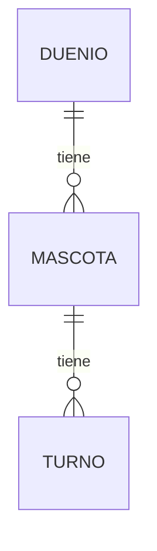

# API Veterinaria

API REST de una veterinaria, hecha como Trabajo Práctico Integrador de Taller de Programación 2 (ORT). Gestiona **dueños**, sus **mascotas** y los **turnos** de atención: cada turno ocupa un horario, y no puede haber dos turnos activos al mismo tiempo.

**Autor:** Santiago Cortina
**Repositorio:** https://github.com/santicortina-97/TP2-2026-INTEGRADOR

**Tecnologías:** Node.js (ES Modules), Express 5, Zod, Sequelize + SQLite y Swagger UI.

## Índice

1. [Dominio y entidades](#dominio-y-entidades)
2. [Relación entre las entidades](#relación-entre-las-entidades)
3. [Reglas de negocio](#reglas-de-negocio)
4. [Arquitectura](#arquitectura)
5. [Instalación y ejecución](#instalación-y-ejecución)
6. [Variables de entorno](#variables-de-entorno)
7. [Cómo cambiar de persistencia](#cómo-cambiar-de-persistencia)
8. [Documentación de la API (Swagger)](#documentación-de-la-api-swagger)
9. [Eventos](#eventos)
10. [Errores](#errores)
11. [Opcionales implementados](#opcionales-implementados)

## Dominio y entidades

| Entidad | Qué es | Campos principales |
|---|---|---|
| **Dueño** | Persona responsable de una o más mascotas | `id`, `nombre`, `email` (único), `telefono` (opcional) |
| **Mascota** | Animal que se atiende en la veterinaria | `id`, `nombre`, `especie` (perro, gato, ave, conejo, otro), `raza` (opcional), `fechaNacimiento` (opcional), `duenioId` |
| **Turno** | Atención reservada para una mascota en una fecha y hora | `id`, `mascotaId`, `fechaHora`, `motivo`, `estado` (pendiente, realizado, cancelado) |

Las tres entidades tienen CRUD completo: listar, obtener por id, crear, actualizar y eliminar. Todas guardan además `createdAt` y `updatedAt`.

Las fechas y horas se reciben en formato ISO 8601 con zona horaria (por ejemplo `2026-12-01T10:00:00-03:00`) y se guardan y devuelven en UTC (`2026-12-01T13:00:00.000Z`). Así, el mismo horario escrito de dos formas distintas se reconoce como el mismo.

## Relación entre las entidades



- Un **dueño** tiene muchas **mascotas** y cada mascota pertenece a un solo dueño (1 a N, por `duenioId`).
- Una **mascota** tiene muchos **turnos** y cada turno pertenece a una sola mascota (1 a N, por `mascotaId`).

## Reglas de negocio

Todas viven en los casos de uso (`usecases/`), no en las rutas ni en los controladores.

| Regla | Error |
|---|---|
| No puede haber dos turnos activos (no cancelados) en la misma fecha y hora. Se verifica al reservar, al cambiar el horario y al reactivar un turno cancelado | `409 TURNO_OCUPADO` |
| El email de un dueño no puede repetirse, sin distinguir mayúsculas (alta y modificación) | `409 EMAIL_DUPLICADO` |
| Para crear o modificar una mascota, el dueño tiene que existir | `404 DUENIO_NOT_FOUND` |
| Para reservar o modificar un turno, la mascota tiene que existir | `404 MASCOTA_NOT_FOUND` |
| No se puede eliminar un dueño que tiene mascotas | `409 DUENIO_CON_MASCOTAS` |
| No se puede eliminar una mascota que tiene turnos | `409 MASCOTA_CON_TURNOS` |

Un turno nuevo siempre empieza en estado `pendiente`. Un turno `cancelado` libera su horario para que otro lo pueda reservar.

## Arquitectura

Arquitectura en capas con inversión de dependencias:

```
Request → routes (validación con Zod) → controllers → usecases → dao → memoria o SQLite
                                                          │
                                                          └→ eventBus → listeners → notificador

Errores → AppError → errorHandler → { "error": { "code", "message", "details" } }
```

| Carpeta | Responsabilidad |
|---|---|
| `config/` | `config.js`: único lugar que lee las variables de entorno |
| `container/` | Composition Root: crea los DAOs, el bus de eventos, los casos de uso, los controladores y los routers |
| `routes/` | Rutas y validación de `body`, `params` y `query` |
| `controllers/` | Traducen HTTP a casos de uso, sin reglas de negocio |
| `usecases/` | Reglas de negocio; reciben sus dependencias por parámetro (`makeXxxUseCases`) |
| `dao/` | Acceso a datos: `memory/` (arrays) y `sequelize/` (SQLite) con la misma interfaz, y `factory.js` que elige cuál usar |
| `dao/models/` | Modelos de Sequelize y asociaciones centralizadas |
| `schemas/` | Schemas de Zod |
| `middlewares/` | `validate`, `notFound` y `errorHandler` |
| `errors/` | `AppError` (`code`, `message`, `statusCode`, `details`) |
| `events/` | Bus de eventos (`EventEmitter`) y listeners |
| `notifications/` | Notificadores |
| `docs/` | `openapi.yaml` y montaje de Swagger UI |

`index.js` solo arranca el servidor y monta el router que entrega el contenedor. Las capas no importan implementaciones concretas: los casos de uso reciben los DAOs y los controladores reciben los casos de uso.

## Instalación y ejecución

**Requisitos:** Node.js 20 o superior y npm. No hace falta instalar SQLite: la base es un archivo que se crea solo.

```bash
git clone https://github.com/santicortina-97/TP2-2026-INTEGRADOR.git
cd TP2-2026-INTEGRADOR
npm install
cp .env.example .env     # en Windows (PowerShell): Copy-Item .env.example .env
npm run dev
```

El servidor queda en `http://localhost:3000` y al arrancar muestra qué persistencia está usando.

| Comando | Qué hace |
|---|---|
| `npm run dev` | Servidor con recarga automática al guardar archivos |
| `npm start` | Servidor normal |

Para comprobar que anda: `http://localhost:3000/api/duenios` responde un listado (vacío la primera vez).

## Variables de entorno

Se leen solo en `config/config.js`. El archivo `.env` no se versiona: se crea a partir de `.env.example`.

| Variable | Default | Descripción |
|---|---|---|
| `PORT` | `3000` | Puerto del servidor |
| `PERSISTENCE_TYPE` | `memory` | Dónde se guardan los datos: `memory` o `sqlite` |
| `DB_STORAGE` | `./veterinaria.sqlite` | Archivo de SQLite (solo con `sqlite`) |

## Cómo cambiar de persistencia

Se elige con `PERSISTENCE_TYPE` en el `.env`. Después de cambiarla hay que **reiniciar el servidor** (`--watch` no detecta cambios en el `.env`).

| `PERSISTENCE_TYPE` | Qué usa | Datos |
|---|---|---|
| `memory` | Arrays de JavaScript | Se pierden al reiniciar el servidor |
| `sqlite` | Sequelize + SQLite, en el archivo de `DB_STORAGE` | Persisten entre reinicios |

`dao/factory.js` crea los DAOs según esa variable. Cada entidad tiene un DAO por modo, con la misma interfaz (`findAll`, `findById`, `create`, `update`, `delete`), y ambos devuelven objetos planos, nunca instancias de Sequelize. Por eso los casos de uso, los controladores y las rutas no cambian, y los dos modos responden igual (misma forma y mismos códigos).

Con `sqlite`, las tablas se crean solas al arrancar. Para empezar con la base vacía: detener el servidor y borrar `veterinaria.sqlite`.

## Documentación de la API (Swagger)

La API está documentada con OpenAPI 3 (`docs/openapi.yaml`) y publicada con Swagger UI en:

**http://localhost:3000/api-docs**

Ahí están todos los endpoints con sus parámetros, ejemplos y respuestas (éxito y errores), y se pueden probar con **Try it out** en cualquiera de los dos modos de persistencia.

Además, `request.http` tiene una secuencia de pruebas manuales para la extensión REST Client de VS Code / Cursor. Está pensado para correrse de arriba hacia abajo con la base vacía.

## Eventos

La aplicación usa un bus de eventos (`EventEmitter`, en `events/eventBus.js`) que se crea y se inyecta desde el contenedor. El caso de uso de turnos emite un evento después de guardar, sin saber quién lo escucha ni qué se hace con él. Si la operación falla, no se emite nada.

| Evento | Se emite cuando | Qué hace su listener |
|---|---|---|
| `turno.creado` | Se reserva un turno | Notifica la reserva: id del turno, mascota, fecha y motivo |
| `turno.cancelado` | Un turno pasa a estado `cancelado` | Notifica que el horario quedó libre |

- Los listeners están en `events/turno.listeners.js` y reciben el notificador por parámetro.
- El notificador (`notifications/ConsoleNotifier.js`) implementa la interfaz `notify(mensaje)` y escribe en la consola del servidor. Para cambiarlo por otro (archivo, mail) alcanza con otra clase con el mismo método y cambiar una línea del contenedor, sin tocar la regla de negocio.
- Cada listener captura sus propios errores con `try/catch`: si la notificación falla, el turno igual queda guardado y la respuesta es 201.

## Errores

Todas las respuestas de error tienen el mismo formato:

```json
{ "error": { "code": "TURNO_OCUPADO", "message": "El horario 2026-12-01T13:00:00.000Z ya está ocupado", "details": null } }
```

| Código HTTP | Cuándo |
|---|---|
| `400 VALIDATION_ERROR` | El body, los params o la query no cumplen el schema de Zod. En `details` va la lista de campos con error |
| `400 INVALID_JSON` | El body no es un JSON válido |
| `404 ..._NOT_FOUND` | No existe el recurso pedido o uno relacionado (`DUENIO_NOT_FOUND`, `MASCOTA_NOT_FOUND`, `TURNO_NOT_FOUND`) |
| `404 ROUTE_NOT_FOUND` | La ruta no existe |
| `409` | Se viola una regla de negocio (ver [Reglas de negocio](#reglas-de-negocio)) |
| `500 INTERNAL_ERROR` | Error inesperado. El detalle queda en la consola del servidor, no se envía al cliente |

Las respuestas exitosas usan `200` (consultar y actualizar), `201` (crear) y `204` sin body (eliminar).

## Opcionales implementados

**Filtros, ordenamiento y paginación** en los tres listados:

| Parámetro | Descripción |
|---|---|
| `page`, `limit` | Página y cantidad por página (por defecto 1 y 10; máximo 100) |
| `sort`, `order` | Campo y sentido del orden (`asc` o `desc`) |
| Dueños | `nombre` (búsqueda parcial) |
| Mascotas | `nombre`, `especie`, `duenioId` |
| Turnos | `mascotaId`, `estado`, `desde`, `hasta` (rango de fechas) |

Los listados responden con `data` y `meta` (`page`, `limit`, `total`, `totalPages`). Ejemplo:

```
GET /api/turnos?estado=pendiente&desde=2026-12-01T00:00:00-03:00&page=1&limit=5
```